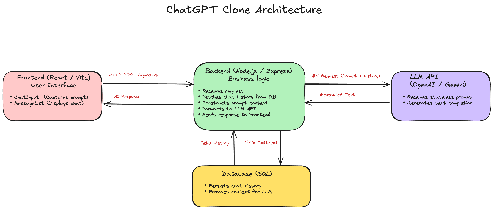

# ChatGPT Clone

A full-stack ChatGPT clone built with React, Node.js, Express, MySQL, and the Google Gemini API.

## Architecture



### Key Features
- **Modern Responsive UI**: Faithful replica of OpenAI's ChatGPT interface with dark theme and interactive sidebar.
- **Markdown & Code Highlighting**: Full markdown rendering with syntax highlighting for code snippets using React Markdown and Prism.
- **Google Gemini Integration**: Powered by `@google/genai` utilizing the `gemini-3.5-flash-lite` model for conversational AI responses.
- **Context-Aware Conversations**: Retains conversation history in MySQL database to maintain multi-turn dialogue context.
- **Optimistic UI Updates**: Smooth instant message updates in the frontend while waiting for AI streaming/generation.

---

## Tech Stack

### Frontend
- **Framework**: React 18 / Vite
- **Icons**: Lucide React
- **Markdown**: `react-markdown`, `react-syntax-highlighter`
- **HTTP Client**: Axios

### Backend
- **Runtime**: Node.js (ES Modules)
- **Server**: Express.js
- **Database**: MySQL (`mysql2/promise` connection pool)
- **AI SDK**: `@google/genai`
- **Configuration**: Dotenv & CORS

---

## Getting Started

### 1. Database Setup
Ensure MySQL is running, then execute the schema in `backend/db/schema.sql`:
```sql
CREATE DATABASE IF NOT EXISTS chatgpt_clone;
USE chatgpt_clone;

CREATE TABLE IF NOT EXISTS conversations (
    id BIGINT UNSIGNED AUTO_INCREMENT PRIMARY KEY,
    role ENUM('user', 'assistant') NOT NULL,
    content TEXT NOT NULL,
    token_count INT UNSIGNED NOT NULL DEFAULT 0,
    created_at TIMESTAMP NOT NULL DEFAULT CURRENT_TIMESTAMP
);
```

### 2. Backend Configuration & Setup
Navigate to the `backend` folder:
```bash
cd backend
npm install
```
Create a `.env` file based on `.env.example`:
```env
DB_HOST=localhost
DB_USER=root
DB_PASSWORD=your_password
DB_NAME=chatgpt_clone
GEMINI_API_KEY=your_gemini_api_key
GEMINI_MODEL=gemini-3.5-flash-lite
```
Start the backend server:
```bash
npm run dev
# or
npm start
```
The server will run on `http://localhost:3888`.

### 3. Frontend Setup
In a new terminal, navigate to the `Frontend` folder:
```bash
cd Frontend
npm install
npm run dev
```
Open your browser at `http://localhost:5173`.

